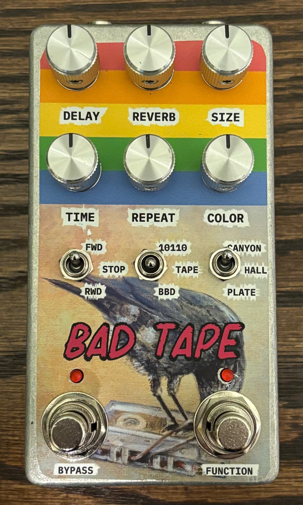
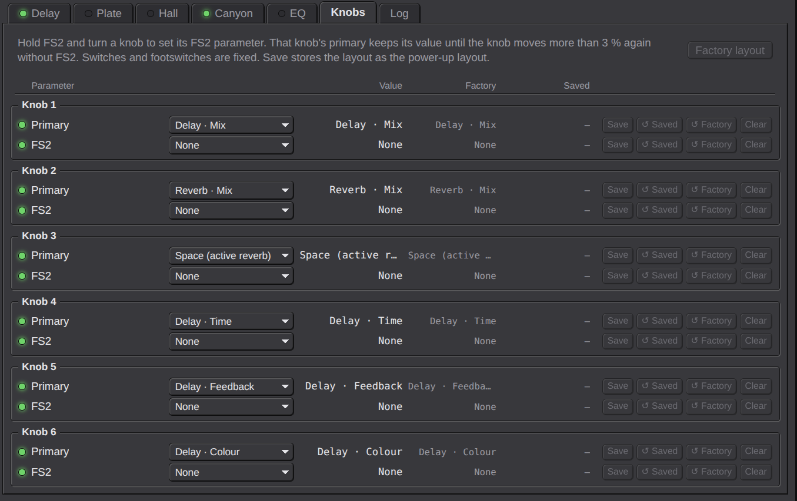
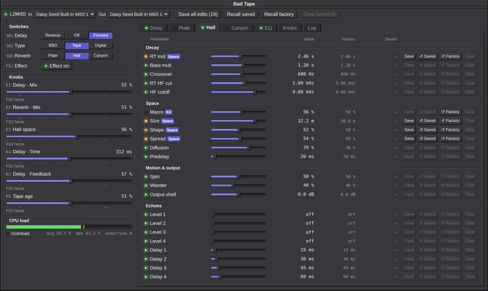
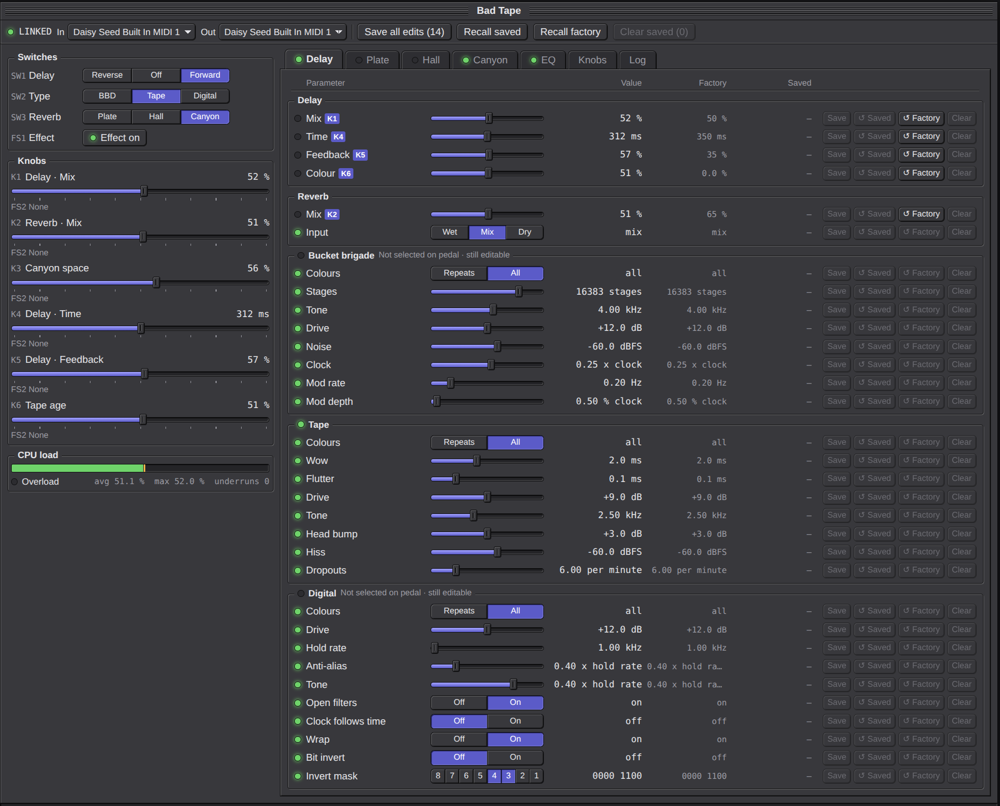
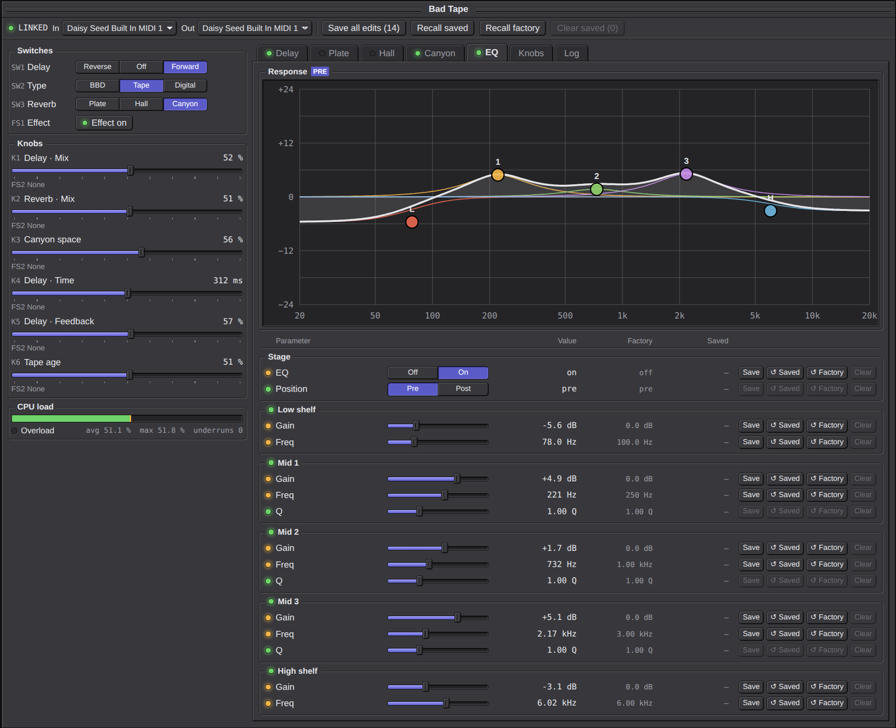

# Bad Tape

A delay and reverb guitar pedal for the [Electrosmith Daisy Seed](https://electro-smith.com/products/daisy-seed) in a [Cleveland Music Co. HotHouse](https://github.com/clevelandmusicco/HothouseExamples) enclosure.

- **EQ**, a five-band parametric (low shelf, three bells, high shelf; ±12 dB, 40 Hz–16 kHz), before the delay or after the reverb; off by default, MIDI and editor only (or a knob you assign to it).
- **Delay**, forward or reverse, 10–2000 ms, in three types with a color knob: BBD (sample degradation), tape (tape age) or digital (bitcrush).
- **Reverb**, three native algorithms: Hall (after the Lexicon 480L Random Hall), Plate (after the Lexicon 224XL Rich Plate) and Canyon (after the Eventide H3000 Breathing Canyon).
- Every parameter is under USB MIDI control (CC, NRPN, SysEx), with a browser editor and saved power-up values. DFU is entered over USB MIDI, so flashing needs no button presses.
- **Remappable knobs**: each knob drives any parameter not on a switch or FS1, and holding FS2 switches every knob to a second parameter of your choice. Set both layers on the editor's Knobs tab; they are saved with the power-up values.



The factory knob layout (no FS2 parameters):

|Row|Left|Middle|Right|
|---|---|---|---|
|Top|Knob 1: delay mix|Knob 2: reverb mix|Knob 3: reverb space|
|Bottom|Knob 4: delay time|Knob 5: delay feedback|Knob 6: delay color

SW1 delay forward/off/reverse, SW2 delay type digital/tape/BBD, SW3 reverb Canyon/Hall/Plate, FS1 bypass (with spillover), FS2 shift (hold for the knobs' FS2 parameters).

These knobs can all be remapped in the editor, shown below:


## Flashing Your Device
For folks who don't want to bother with building their own firmware, you can grab one from Releases.

Grab the `bad_tape.bin` file from [Releases](https://github.com/jimbattin/bad_tape/releases) optionally along with the firmware version's corresponding `editor.html`, which currently supports Google Chrome over Web MIDI.

Navigate to Daisy's web programmer: https://flash.daisy.audio/ and upload and flash `bad_tape.bin`

## Editor
You can also grab `editor.html` for control of over 130 parameters - these can be tweaked live, saved as new default, or you can revert back to "factory" to get back home.

### Reverb


### Delay


### EQ


## Build

```sh
git submodule update --init --recursive && make -C daisy/libDaisy
make -C daisy -j                    # needs the Arm GNU Toolchain on PATH
daisy/tools/flash_when_ready.sh     # needs dfu-util and uv
make test                           # host tests (needs GoogleTest via pkg-config)
make -C editor serve                # editor at http://localhost:3000/ (needs Bun)
```

## Documentation

- [`daisy/README.md`](daisy/README.md): firmware: controls, signal flow, USB MIDI link, log, performance, memory map.
- [`docs/MIDI.md`](docs/MIDI.md): the MIDI implementation (generated from `daisy/src/params.h`).
- [`docs/EQ.md`](docs/EQ.md): the EQ's specification.
- [`editor/README.md`](editor/README.md): the browser editor.
