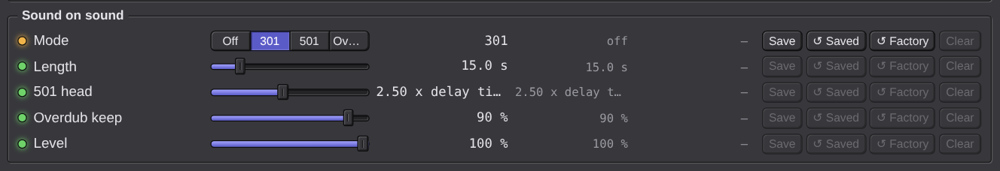
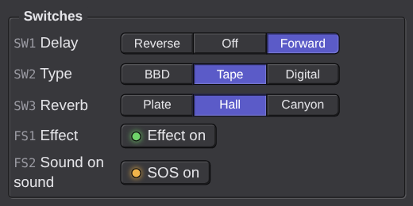

# Sound on sound

Old tape echoes had extra playback heads that could bring your playing back much later. Bad Tape's sound on sound (SOS) gives you three takes on that, and they work with every delay type (BBD, tape, digital).

A *head* is a point that plays back what was recorded a set time ago. A *loop* is a stretch of your playing that keeps repeating.

## Quick start

1. Connect the pedal and open the editor.
2. On the Delay tab, find "Sound on sound" and pick a Mode: Off, 301, 501 or Overdub (its button reads "Ov…").

   

3. Play, then tap FS2. LED2 blinks while SOS is on.
4. Tap FS2 again to turn it off.
5. The mode is saved with Save, like any setting. SOS itself always starts off at power-up.

## Tap or hold?

A quick tap and release of FS2 turns SOS on or off.

Holding FS2 while you turn a knob changes that knob's FS2 setting instead, and SOS stays as it was. Out of the box, knob 4 (delay time) sets the SOS *Length* this way: hold FS2, turn knob 4, let go. Moving a toggle switch while FS2 is down also cancels the tap.

The FS2 button in the editor's sidebar does the same as a tap.

## The modes

|Mode|What you hear|Try it for|
|---|---|---|
|Off|SOS is disabled, and tapping FS2 does nothing.|Keeping FS2 for the knobs only.|
|301|Whatever you played *Length* seconds ago comes back once, echoes and all.|Playing a duet with yourself.|
|501|An extra, later echo at *501 head* × the delay time (2.5× by default). It repeats along with the Feedback knob.|Longer, more complex echo patterns.|
|Overdub|Switching on loops the last *Length* seconds and keeps adding what you play on top. Each pass gets a little quieter (*Overdub keep*). Switching off stops the loop playing, and new playing replaces it over the next *Length* seconds.|Building layers, like a looper.|

## Settings

- **Length**: 10–120 s, used by 301 and Overdub. On the pedal: hold FS2 and turn knob 4.
- **501 head**: 1.25–4 × the delay time.
- **Overdub keep**: 0–100 %, how much of the loop survives each pass. At 100 % it never fades.
- **Level**: 0–100 %, how loud SOS plays.

## Tips

- In Overdub, put SW1 in the middle to stop adding new sound while the loop keeps playing.
- SOS plays through the delay's wet signal, so knob 1 (delay mix) sets how much of it you hear.
- SOS keeps playing when you bypass with FS1.
- A MIDI controller can switch SOS with CC 26 (values 64 and up mean on). See [MIDI.md](MIDI.md).
- The 301 and 501 modes are named after the Roland RE-301 and RE-501 Space Echo, which had these heads.
